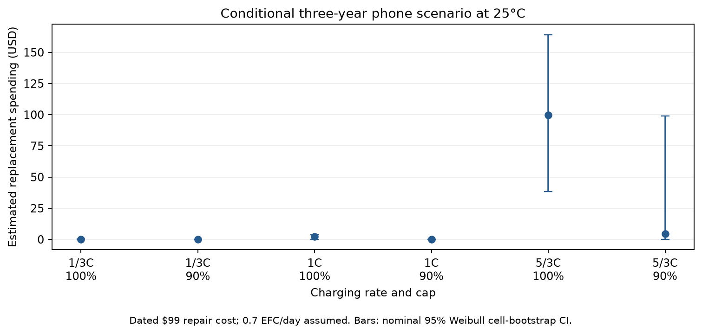
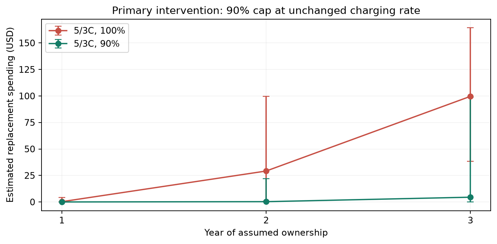

# Financial Impacts

## Financial Impacts

A 90% cap at unchanged 5/3C charging is the prespecified intervention, compared with 100% charging at 25°C. Using KIT lifetime estimates, a conditional three-year phone scenario projects replacement spending of $99.62 before versus $4.49 after, saving $95.13 per owner (nominal 95% cell-bootstrap interval $12.97–$139.16). These are model estimates, not observed smartphone savings (Luh & Blank, 2024).

The monetary input is a dated $99 iPhone 16 repair fee reported in September 2024, not a verified current quotation (Burkhardt, 2024). Apple's accessible service page did not load numeric pricing when checked on November 1, 2026. Taxes, shipping, and additional service charges are excluded by assumption (Apple, n.d.). We adopt Apple's three-year first-owner power-use horizon and the weak review-site estimate of 0.7 nominal EFC/day: 766.5 EFC per strategy (Apple, 2024; Aussems, 2025). Equal throughput prevents the cap from appearing beneficial simply because each partial cycle delivers less charge.

A renewal calculation replaces each battery at 80% initial capacity with a fresh lifetime from the same fitted strategy. Expected replacements decline from 1.006 to 0.045; the probability of at least one replacement declines from 99.8% to 4.5%. Existing chargers and a free policy change are assumed. The estimated break-even implementation cost is therefore $95.13 per owner under this scenario. Charging inconvenience and time are not monetized.

Uncertainty comes from 2,000 whole-cell bootstrap refits, propagated through replacement calculations. Numerical renewal expectations agree with separately labeled simulation checks; halving the EFC grid changes expected spending by less than $0.02. Price, usage, and transfer sensitivities are scenarios rather than confidence intervals. The alternative lognormal model projects $80.24 saving; the $119 Pro-model repair fee is a dated alternative price, not uncertainty about today's base-model fee.

The 766.5-EFC horizon exceeds the baseline group's last valid measured follow-up, requiring extrapolation. Weibull predicts held-out observations worse than lognormal. Further, KIT uses cylindrical cells and liquid cooling; phone transfer, everyday usage, and repeated-replacement behavior remain unvalidated. No separate calendar-aging model is fitted. The results justify funding smartphone-cell validation and a charging-policy pilot, not booking fleet savings or promising a guaranteed benefit. A positive lower interval endpoint reflects the fitted model, not protection against these structural assumptions.

## Supporting results

Distribution inputs: S(t)=exp[-(t/eta)^k], location fixed at zero; k=7.018 (nominal 95% CI 6.324–12.936). Table 2 lists each eta in EFC. The lognormal sensitivity has sigma=0.181004 and each listed median, with log L normally distributed. These are fitted parameters, not additional cell measurements.

Scenario settings: 25°C; 0.80 initial-capacity replacement threshold; horizon 766.5 nominal EFC; lifetime-transfer multiplier 1 (assumed, unvalidated); independent fresh replacement lives; renewal grid 0.25 EFC, checked at half that step. Zero location is fixed, not fitted. Uncertainty uses the same 2,000 joint cell-bootstrap fits, not independent draws from marginal parameter intervals.

Sensitivity settings: assumed use 0.5/0.7/1.0 EFC/day; assumed lifetime multipliers 0.5/1/2; dated repair scenarios $99/$119. These values define scenarios, not observed phone usage distributions or confidence bounds. No discounting is applied. Common-shape assumptions and the weaker Weibull held-out performance remain limitations.

Table 1. Financial inputs. All money is illustrative USD, using a dated repair estimate.

| Input | Value | Evidence status |
| --- | --- | --- |
| battery_replacement_price | 99.0 USD | sourced_dated_estimate |
| price_sensitivity | 119.0 USD | sourced_dated_alternative |
| ownership_years | 3.0 years | assumed_with_source |
| usage_EFC_day | 0.7 nominal EFC/day | assumed_with_weak_source |
| incremental_implementation_cost | 0.0 USD | assumed |
| additional_service_fee | 0.0 USD | assumed |

Table 2. Lifetime-distribution inputs to the 25°C financial scenarios. All rows share Weibull shape k; scales and lognormal medians are estimates. Lognormal sensitivity values are point estimates only.

| Strategy | Weibull scale (EFC) | Scale 95% CI | Lognormal median (EFC) |
| --- | --- | --- | --- |
| 1/3C 100% | 2,015.104 | [1,861.721, 2,159.845] | 2,003.253 |
| 1/3C 90% | 3,200.044 | [2,866.048, 3,764.317] | 3,204.238 |
| 1C 100% | 1,310.708 | [1,229.095, 1,411.857] | 1,233.257 |
| 1C 90% | 2,345.022 | [2,057.733, 2,819.225] | 2,206.623 |
| 5/3C 100% | 593.674 | [388.482, 819.616] | 472.546 |
| 5/3C 90% | 1,187.051 | [581.257, 1,372.309] | 875.764 |

Table 3. Conditional three-year replacement spending and savings versus 5/3C/100% at 25°C. Intervals are nominal 95% cell-bootstrap intervals conditional on Weibull/phone-transfer assumptions.

| Strategy | Expected replacements | Spending USD | Saving USD [95% CI] |
| --- | --- | --- | --- |
| 1/3C 100% | 0.001 | $0.11 | $99.51 [$38.36, $164.16] |
| 1/3C 90% | 0.000 | $0.00 | $99.62 [$38.37, $164.22] |
| 1C 100% | 0.023 | $2.27 | $97.35 [$38.12, $162.78] |
| 1C 90% | 0.000 | $0.04 | $99.58 [$38.37, $164.20] |
| 5/3C 100% | 1.006 | $99.62 | $0.00 [$0.00, $0.00] |
| 5/3C 90% | 0.045 | $4.49 | $95.13 [$12.97, $139.16] |

## References

Luh, M., & Blank, T. (2024). Comprehensive battery aging dataset: capacity and impedance fade measurements of a lithium-ion NMC/C-SiO cell. Scientific Data, 11, 1004. https://doi.org/10.1038/s41597-024-03831-x. Version 2 result data: https://doi.org/10.35097/1969; supplied README, data dictionary and cell overview. CC BY 4.0; analysis adapted by this project.

Burkhardt, M. (2024, September 15). iPhone 16 Pro battery replacements will cost even more than last year. 9to5Mac. https://9to5mac.com/2024/09/15/iphone-16-pro-battery-replacement/ (accessed November 1, 2026; dated price scenario).

Apple Inc. (2024). iPhone 16 and iPhone 16 Plus Product Environmental Report, p. 9. https://www.apple.com/environment/pdf/products/iphone/iPhone_16_and_iPhone_16_Plus_PER_Sept2024.pdf (accessed November 1, 2026).

Aussems, M. (2025, July 4). iPhone battery twice as bad as Samsung: which manufacturer performs best? ITdaily. https://itdaily.com/blogs/workplace/iphone-battery-twice-as-bad-as-samsung-which-manufacturer-performs-best/ (accessed November 1, 2026; weak usage source).

Apple Inc. (n.d.). Apple service and repair for iPhone battery. https://support.apple.com/iphone/repair/battery-replacement (accessed November 1, 2026; numeric pricing failed to load).
