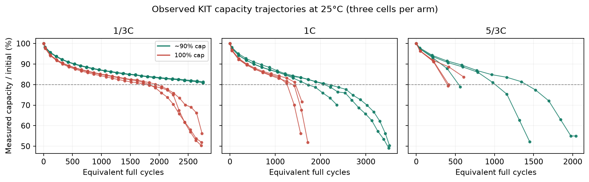
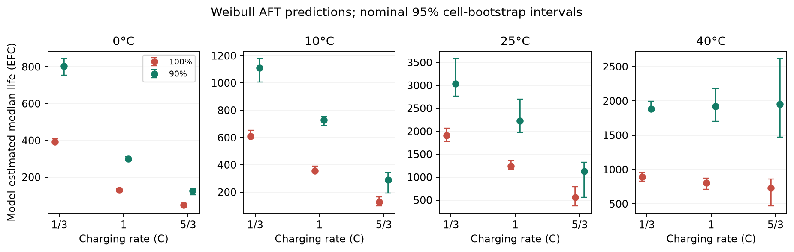
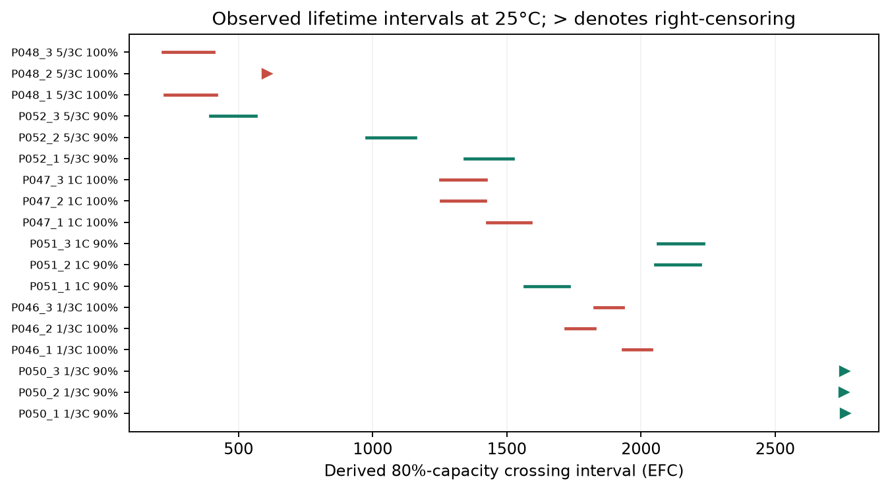

# Preliminary Methods and Results

## Measures

We measure standardized discharge capacity in ampere-hours and capacity retention relative to each cell's first valid reference measurement. The primary endpoint is equivalent-full-cycle exposure until capacity first falls below 80% of that initial measurement. Because reference tests are intermittent, a crossing is an interval between observations; cells without a crossing are right-censored. Equivalent full cycles (EFC) equal average cumulative charging and discharging throughput divided by nominal 3 Ah capacity, with baseline exposure subtracted. Total exposure includes diagnostic operations; operating-only exposure is a sensitivity measure. Predictors are charging rate, regular-operation charging cap, and controlled bath temperature. Observed trajectories and endpoint coverage describe the experimental evidence. Life ratios, median lifetimes, survival probabilities, and their confidence intervals are explicitly model estimates, not additional measurements (Luh & Blank, 2024).

## Assumptions

The 72 selected cells represent this KIT experiment, not smartphone batteries generally. We assume a common Weibull shape and independent cell variation conditional on experimental conditions; shared baths limit independent temperature replication. Upper voltage represents an approximate 90% or 100% cap, not a continuously recalibrated SOC limit. Capping also changes cycle depth, so it does not isolate one degradation mechanism. Diagnostic tests periodically charge both groups fully. Missing capacities remain missing, and incomplete lifetimes remain censored. Three flagged cold measurements and the final manual check-up are excluded initially. Alternative models and inclusion rules assess sensitivity. Smartphone financial projections additionally assume transferable lifetime, constant usage, and fresh replacement batteries; these assumptions are not validated observations.

## Model / approach

We analyzed the downloaded KIT version 2 result data, not simulated cell observations (Luh & Blank, 2024). Selection fixed discharge at 1C and the lower voltage at 3.249 V, leaving three charging rates (1/3C, 1C, 5/3C), two upper limits (approximately 90%, 100%), four bath temperatures (0, 10, 25, 40°C), and three physical replicates in each of 24 combinations. We verified archive checksums, mapped termination reasons from the supplied workbook, and linked reference capacities to original CSV rows.

An accelerated-failure-time regression models log lifetime scale using categorical factors and all two-factor interactions; 1C, 100%, and 25°C define the reference. The survival equation is S(t|x)=exp[-(t/eta(x))^k], with scale eta(x)=1000 exp(X beta) EFC and location fixed at zero. The common shape k pools information across sparse groups. Interval likelihoods retain uncertain crossing times, while survival likelihoods retain cells that stopped before a crossing. No midpoint is substituted as an observed failure. We resampled whole cells within conditions 2,000 times, refitting each sample to obtain nominal percentile confidence intervals. Repeated check-ups are not independent replicates.

Approximate likelihood-ratio tests assess the three interactions with Holm correction. Balanced three-fold validation withholds one replicate per condition and scores its censored predictive likelihood. Prespecified sensitivities use a lognormal distribution, rated-capacity normalization, operating-only throughput, flagged/final measurements, and pessimistic shutdown events. These checks assess dependence on model and censoring choices; they cannot establish smartphone transfer. Tables distinguish observed or derived endpoints from model estimates.

## Results

The primary dataset contains 72 cells and 859 retained reference-capacity measurements. There are 63 observed threshold-crossing intervals and 9 right-censored endpoints. Exclusions comprise 11 final-manual and three cold records within selected cells; no capacity readings were imputed. Individual trajectories show substantial variation despite identical nominal settings. Three cells per combination remain the experimental replication, regardless of bootstrap count.

At 25°C, the Weibull model estimates median life at 100% charging as 1,913, 1,244, and 563 EFC for 1/3C, 1C, and 5/3C respectively. Corresponding 90%-cap medians are 3,037, 2,226, and 1,127 EFC. For the prespecified 5/3C cap comparison, nominal 95% intervals are [371, 790] EFC without the cap and [561, 1,323] EFC with it. The estimated life ratio is 2.00 [95% CI 1.31, 2.92]. This is a model-based comparison, not an observed doubling for every cell.

At the reference 1C/25°C condition, the cap coefficient on log lifetime scale is 0.582 [95% CI 0.422, 0.779]. The charging-rate-by-temperature interaction is supported by an approximate likelihood-ratio statistic of 75.53 on six degrees of freedom (Holm-adjusted p < 0.001). Rate-by-cap and cap-by-temperature tests have adjusted p-values 0.372 and 0.372. These nonsignificant interactions do not establish equal cap benefits everywhere. Individual contrast intervals are nominal, without multiplicity adjustment.

At 5/3C without the cap, estimated median life is 48 EFC at 0°C and 734 EFC at 40°C, compared with 563 EFC at 25°C. This variation makes a single temperature-independent charging-rate penalty inappropriate. In the measured 25°C baseline group, two cells cross within intervals ending near 408 and 416 EFC, while the third remains uncrossed at approximately 606 EFC. The capped group also varies substantially. These observations explain why a pooled fitted median cannot be described as the actual lifetime of any individual cell.

All 2,000 bootstrap fits converged. However, held-out prediction exposes important model dependence: summed log likelihood is -463.6 for Weibull versus -152.7 for lognormal; higher is better. We retain the prespecified Weibull results but do not interpret their intervals as covering distributional uncertainty. The lognormal sensitivity estimates 5/3C median life at 473 EFC for 100% charging and 876 EFC for the cap. Direction agrees, but magnitude changes.

At 1/3C/25°C, all three capped cells remain above the threshold; their estimated median therefore extends beyond observed follow-up. Fault-related shutdowns also challenge independent censoring. Temperature findings are conditional on one apparatus, and controlled liquid cooling differs from phone operation. The experiment supports a cap-and-rate comparison in these NMC/graphite-SiO cells. It does not establish absolute smartphone life or an independently replicated causal temperature effect. Smartphone validation is the appropriate next investment before operational rollout.

## Supporting results

Distribution definitions: t is baseline-subtracted EFC; k is Weibull shape and eta(x) is condition-specific scale. S(t|x)=exp[-(t/eta(x))^k] for t >= 0. Scale eta is the 63.2th failure percentile, not the median. Median life = eta(x)*(ln 2)^(1/k). Location is fixed at zero.

Coding: log(eta(x)/1000 EFC)=X beta. X contains an intercept and binary indicators for rate_1third (1/3C), rate_5third (5/3C), cap90, and temp0/temp10/temp40, plus all cross-factor two-way products. Reference indicators are all zero at 1C/100%/25°C; no three-way term is fitted. All logarithms are natural.

Bootstrap intervals transform each complete fitted parameter vector before taking percentiles; median intervals preserve the dependence between shape and scale. Coefficients are rounded for display; full precision and all 24 condition scales are in outputs/kit/distribution_parameters.csv and model.json.

Lognormal sensitivity: log(L/1000 EFC)=X beta_LN + sigma Z, where Z is standard normal, sigma=0.181004, and the reference median is 1,233.257 EFC. Its scale is a median, unlike Weibull eta. These are point estimates only; no secondary bootstrap intervals were calculated. All lognormal coefficients are in outputs/kit/lognormal_regression.csv.

Fixed protocol and endpoint settings: discharge 1C; lower voltage 3.249 V; upper voltages 4.092 V (~90%) and 4.200 V (~100%); nominal capacity 3 Ah; endpoint 0.80 of each cell’s initial valid capacity. These are design/analysis settings rather than fitted degradation parameters. The seed is 20261101 and there are 2,000 successful cell-bootstrap fits.

Table 1. Derived endpoint coverage after prespecified exclusions. Crossings are intervals, not exact failures.

| Bath °C | Cells | Crossings | Right-censored |
| --- | --- | --- | --- |
| 0 | 18 | 16 | 2 |
| 10 | 18 | 17 | 1 |
| 25 | 18 | 14 | 4 |
| 40 | 18 | 16 | 2 |

Table 2. Weibull parameters transformed from existing fitted/bootstrap vectors. Reference condition: 1C, 100% cap, 25°C. All estimates and intervals are conditional on this model.

| Parameter | Estimate | Nominal 95% CI | Units / status |
| --- | --- | --- | --- |
| Common shape k | 7.018 | [6.324, 12.936] | Dimensionless; estimated |
| Reference scale eta | 1,310.708 | [1,229.095, 1,411.857] | EFC; estimated |
| Reference median | 1,244.016 | [1,170.005, 1,358.010] | EFC; model-derived |
| Location | 0 | Not estimated | EFC; fixed at zero |

Table 3. Model-estimated Weibull AFT coefficients with bootstrap SE and nominal 95% intervals. Intercept is log(reference scale/1000 EFC); log_shape is log(k). Interaction terms multiply the indicated binary indicators. No individual coefficient p-values are claimed.

| Term | Estimate | Bootstrap SE | 95% CI |
| --- | --- | --- | --- |
| Intercept | 0.27057 | 0.03698 | [0.20628, 0.34491] |
| rate_1third | 0.43010 | 0.04388 | [0.33475, 0.50117] |
| rate_5third | -0.79199 | 0.20868 | [-1.22389, -0.47809] |
| cap90 | 0.58173 | 0.09103 | [0.42171, 0.77870] |
| temp0 | -2.26219 | 0.04644 | [-2.34866, -2.16378] |
| temp10 | -1.25396 | 0.05108 | [-1.34234, -1.14390] |
| temp40 | -0.43057 | 0.06988 | [-0.59860, -0.33028] |
| rate_1third:cap90 | -0.11923 | 0.03977 | [-0.19601, -0.04101] |
| rate_5third:cap90 | 0.11117 | 0.16111 | [-0.23412, 0.38585] |
| rate_1third:temp0 | 0.67701 | 0.04422 | [0.59630, 0.76841] |
| rate_1third:temp10 | 0.10998 | 0.04659 | [0.03218, 0.21398] |
| rate_1third:temp40 | -0.33172 | 0.07075 | [-0.43485, -0.16391] |
| rate_5third:temp0 | -0.19954 | 0.17161 | [-0.42121, 0.19992] |
| rate_5third:temp10 | -0.23880 | 0.23812 | [-0.70403, 0.23269] |
| rate_5third:temp40 | 0.69498 | 0.23727 | [0.30261, 1.20155] |
| cap90:temp0 | 0.25543 | 0.10486 | [0.03631, 0.42430] |
| cap90:temp10 | 0.13738 | 0.12351 | [-0.17772, 0.30191] |
| cap90:temp40 | 0.28369 | 0.11820 | [0.06040, 0.52613] |
| log_shape | 1.94852 | 0.18689 | [1.84442, 2.56005] |

Table 4. Approximate interaction likelihood-ratio tests; three-test Holm correction.

| Interaction | LR | df | Raw p | Holm p |
| --- | --- | --- | --- | --- |
| rate:cap | 3.13 | 2 | 0.209 | 0.372 |
| rate:temp | 75.53 | 6 | 2.98e-14 | 8.94e-14 |
| cap:temp | 4.81 | 3 | 0.186 | 0.372 |

Table 5. Condition-specific Weibull scale and median life at 25°C, with nominal 95% intervals. Shape k is common. *Median exceeds maximum follow-up in that condition. Scales are estimated distribution parameters, not measured lifetimes.

| Rate | Cap | Scale eta (EFC) | Scale 95% CI | Median EFC | Median 95% CI |
| --- | --- | --- | --- | --- | --- |
| 1/3C | 100% | 2,015.1 | [1,861.7, 2,159.8] | 1,913 | [1,782, 2,069] |
| 1/3C | 90% | 3,200.0 | [2,866.0, 3,764.3] | 3,037* | [2,763, 3,584] |
| 1C | 100% | 1,310.7 | [1,229.1, 1,411.9] | 1,244 | [1,170, 1,358] |
| 1C | 90% | 2,345.0 | [2,057.7, 2,819.2] | 2,226 | [1,971, 2,699] |
| 5/3C | 100% | 593.7 | [388.5, 819.6] | 563 | [371, 790] |
| 5/3C | 90% | 1,187.1 | [581.3, 1,372.3] | 1,127 | [561, 1,323] |

## References

Luh, M., & Blank, T. (2024). Comprehensive battery aging dataset: capacity and impedance fade measurements of a lithium-ion NMC/C-SiO cell. Scientific Data, 11, 1004. https://doi.org/10.1038/s41597-024-03831-x. Version 2 result data: https://doi.org/10.35097/1969; supplied README, data dictionary and cell overview. CC BY 4.0; analysis adapted by this project.
