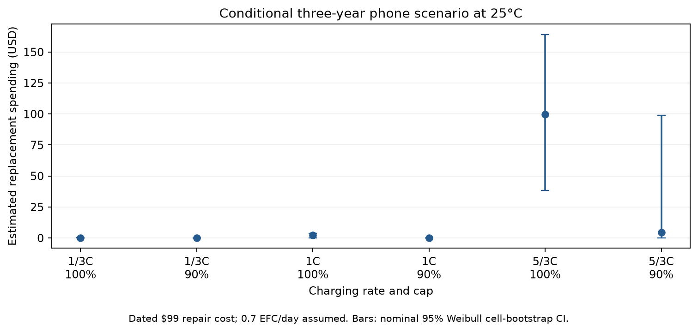
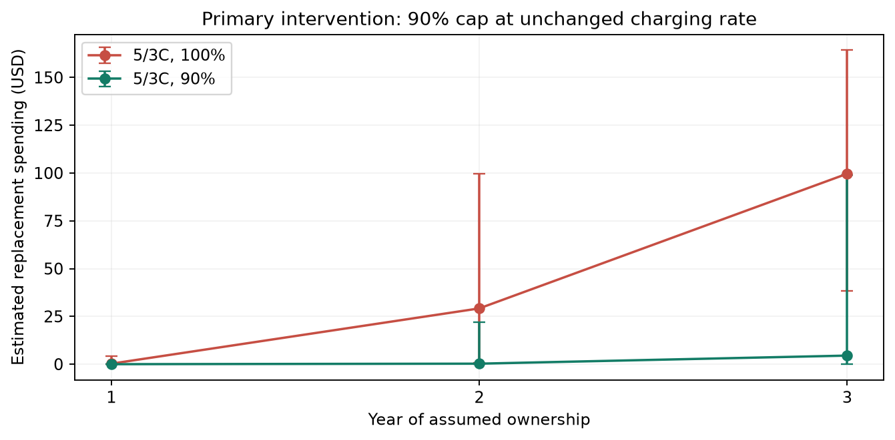

# Financial Impacts

## Financial Impacts

We propose capping 5/3C charging at approximately 90% instead of 100%, at 25°C, as prespecified. In our three-year phone scenario, estimated replacement spending falls from $99.62 to $4.49: $95.13 saved per owner (nominal 95% cell-bootstrap interval $12.97–$139.16). These projections depend on KIT cells; we haven't observed phone savings (Luh & Blank, 2024).

We use a September 2024 iPhone 16 fee estimate of $99, with $119 for Pro-model sensitivity (Burkhardt, 2024). Current pricing failed to load on Apple's page (Apple, n.d.). We assume zero additional fees, tax, shipping and implementation costs. Apple's three-year horizon and a weak review-site estimate of 0.7 nominal EFC/day give 766.5 EFC per strategy (Apple, 2024; Aussems, 2025). Equal delivered charge prevents crediting capping for smaller charges per session.

We replace batteries at 80% initial capacity, assuming independent fresh replacement lives in a renewal calculation. S(t)=exp[-(t/eta)^k] uses common shape k=7.018 (95% CI 6.324–12.936), zero location and the tabulated strategy scales. We assume existing chargers, lifetime-transfer multiplier 1, no discounting and no separate calendar-aging model. Expected replacements fall from 1.006 to 0.045; any-replacement probability falls from 99.8% to 4.5%. Break-even implementation spending is $95.13 per owner. We don't price inconvenience in this financial scenario.

We calculate intervals from 2,000 whole-cell bootstrap refits. The 0.25-EFC renewal grid agrees with separately labeled simulation; halving the step changes spending by less than $0.02. We test assumed usage of 0.5–1.0 EFC/day and lifetime multipliers 0.5/1/2 as sensitivities, not confidence bounds. Lognormal, with sigma=0.181004 and the listed medians, gives $80.24 savings without a secondary bootstrap.

The horizon exceeds baseline measured follow-up, requiring extrapolation, and Weibull predicts held-out observations worse than lognormal. Phone transfer and everyday replacement behavior remain unvalidated. Positive conditional intervals leave those structural uncertainties out. I'd support funding validation and a pilot. We can't yet book fleet savings or guarantee benefits.

Table 1. Sourced/assumed financial inputs.

| Input | Value | Evidence status |
| --- | --- | --- |
| battery_replacement_price | 99.0 USD | sourced_dated_estimate |
| price_sensitivity | 119.0 USD | sourced_dated_alternative |
| ownership_years | 3.0 years | assumed_with_source |
| usage_EFC_day | 0.7 nominal EFC/day | assumed_with_weak_source |
| incremental_implementation_cost | 0.0 USD | assumed |
| additional_service_fee | 0.0 USD | assumed |

Table 2. Estimated 25°C distribution inputs; lognormal values are point estimates.

| Strategy | Weibull eta/EFC | 95% CI | Lognormal median/EFC |
| --- | --- | --- | --- |
| 1/3C 100% | 2,015.104 | 1,861.721–2,159.845 | 2,003.253 |
| 1/3C 90% | 3,200.044 | 2,866.048–3,764.317 | 3,204.238 |
| 1C 100% | 1,310.708 | 1,229.095–1,411.857 | 1,233.257 |
| 1C 90% | 2,345.022 | 2,057.733–2,819.225 | 2,206.623 |
| 5/3C 100% | 593.674 | 388.482–819.616 | 472.546 |
| 5/3C 90% | 1,187.051 | 581.257–1,372.309 | 875.764 |

Table 3. Conditional spending/saving versus 5/3C/100%; 95% intervals.

| Strategy | Replacements | Spending/USD | Saving/USD (95% CI) |
| --- | --- | --- | --- |
| 1/3C 100% | 0.001 | $0.11 | $99.51 ($38.36–$164.16) |
| 1/3C 90% | 0.000 | $0.00 | $99.62 ($38.37–$164.22) |
| 1C 100% | 0.023 | $2.27 | $97.35 ($38.12–$162.78) |
| 1C 90% | 0.000 | $0.04 | $99.58 ($38.37–$164.20) |
| 5/3C 100% | 1.006 | $99.62 | $0.00 ($0.00–$0.00) |
| 5/3C 90% | 0.045 | $4.49 | $95.13 ($12.97–$139.16) |

## References

Luh, M., & Blank, T. (2024). Comprehensive battery aging dataset: capacity and impedance fade measurements of a lithium-ion NMC/C-SiO cell. Scientific Data, 11, 1004. https://doi.org/10.1038/s41597-024-03831-x. Version 2 result data: https://doi.org/10.35097/1969; supplied README, data dictionary and cell overview. CC BY 4.0; analysis adapted by this project.

Burkhardt, M. (2024, September 15). iPhone 16 Pro battery replacements will cost even more than last year. 9to5Mac. https://9to5mac.com/2024/09/15/iphone-16-pro-battery-replacement/ (accessed November 1, 2026; dated price scenario).

Apple Inc. (2024). iPhone 16 and iPhone 16 Plus Product Environmental Report, p. 9. https://www.apple.com/environment/pdf/products/iphone/iPhone_16_and_iPhone_16_Plus_PER_Sept2024.pdf (accessed November 1, 2026).

Aussems, M. (2025, July 4). iPhone battery twice as bad as Samsung: which manufacturer performs best? ITdaily. https://itdaily.com/blogs/workplace/iphone-battery-twice-as-bad-as-samsung-which-manufacturer-performs-best/ (accessed November 1, 2026; weak usage source).

Apple Inc. (n.d.). Apple service and repair for iPhone battery. https://support.apple.com/iphone/repair/battery-replacement (accessed November 1, 2026; numeric pricing failed to load).
