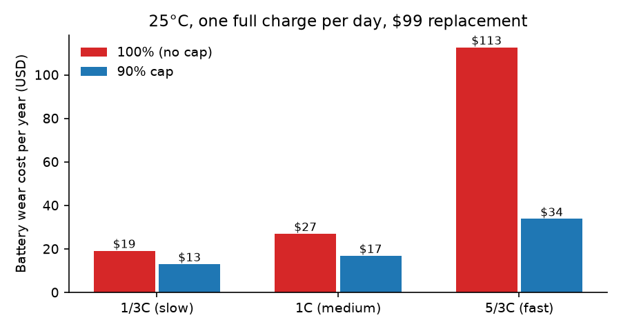

# Capping Fast Charging: Financial Impacts

## Financial Impacts

We estimate what battery wear costs a phone owner each year, and how much a 90% charge cap saves. The battery lives come from the KIT measurements at 25°C (Table 1 of our methods report). Only one input comes from outside the data: a $99 battery replacement fee (Burkhardt, 2024).

The calculation is simple arithmetic. Yearly wear cost = replacement price × cycles used per year ÷ cycles the battery lasts. A battery that lasts 1,000 cycles, used once a day, is used up at 365/1,000 of a battery per year, which costs about $36 a year. We do not know how many full cycles a typical owner uses, so we show 0.5, 1 and 1.5 cycles per day as scenarios rather than claiming one value. The formula is proportional, so a higher replacement fee, such as a Pro model's, raises every cost and saving by the same percentage.

Our main estimate uses 1C charging, where all six cells clearly wore past 80% before testing ended, so every battery life is a measured value. At one full charge a day, the battery lasts 3.8 years without a cap and 5.7 years with one, so wear cost falls from $26 to $17 a year, saving $9 (Table 2, Figure 1). Across our usage scenarios, the saving is $4 to $13 a year. The cap costs nothing to implement as a software setting; its trade-off is about 10% less charge available each day.

Fast charging shows how large the benefit could be. At 5/3C, capping cuts wear cost from $87 to $36 a year, saving $51 ($26 to $77 across usage scenarios). This figure is less certain: all three uncapped fast-charged cells stopped on equipment errors, and one had not yet reached 80%. For slow 1/3C charging the saving is at least $7, since capped cells never wore out during testing.

These numbers have limits. They count cycling wear only; real batteries also age with time, so very long lives (over about five years) overstate the benefit. And the KIT cells are cylindrical 3 Ah cells, not phone batteries. We therefore recommend offering a 90% charge cap as a default, especially for users who fast-charge, and confirming the savings on real phone batteries before promising a dollar figure.

Table 2. How long the battery lasts and its yearly wear cost at 25°C, one full cycle per day, $99 replacement; ≥ means at least and ≤ means at most.

| Charge rate | Lasts, no cap (years) | Lasts, 90% cap (years) | Cost per year, no cap | Cost per year, 90% cap | Saving per year |
| --- | --- | --- | --- | --- | --- |
| 1/3C | 5.0 | ≥7.6 | $20 | ≤$13 | ≥$7 |
| 1C | 3.8 | 5.7 | $26 | $17 | $9 |
| 5/3C | 1.1 | 2.8 | $87 | $36 | $51 |

## References

Luh, M., & Blank, T. (2024). Comprehensive battery aging dataset: capacity and impedance fade measurements of a lithium-ion NMC/C-SiO cell. Scientific Data, 11, 1004. https://doi.org/10.1038/s41597-024-03831-x. Version 2 result data: https://doi.org/10.35097/1969 (CC BY 4.0).

Burkhardt, M. (2024, September 15). iPhone 16 Pro battery replacements will cost even more than last year. 9to5Mac. https://9to5mac.com/2024/09/15/iphone-16-pro-battery-replacement/
