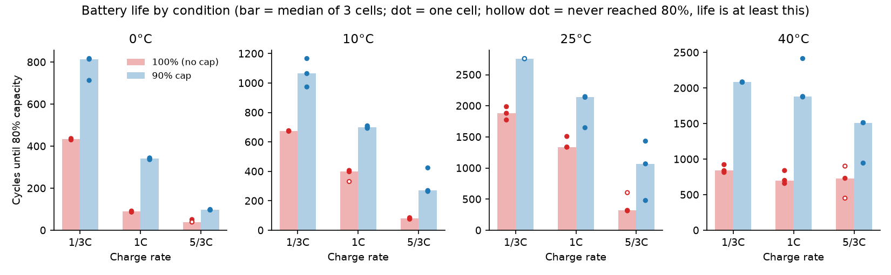
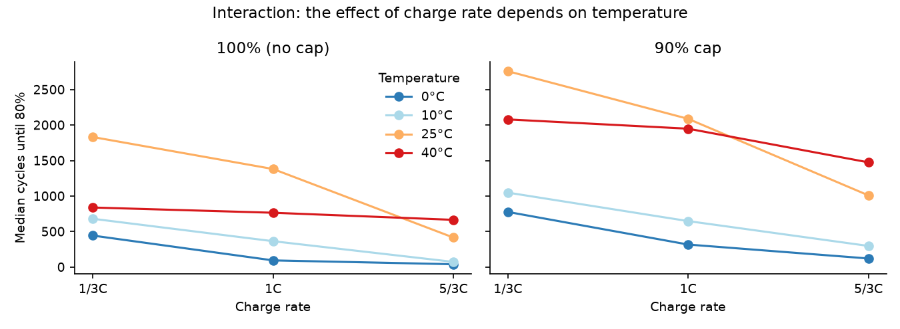

# Preliminary Methods and Results

## Measures

Capacity is the amount of charge a battery can hold, in ampere-hours (Ah). It shrinks as the battery ages, which is why an old phone runs out sooner. Our outcome is **battery life**: the number of equivalent full cycles until a cell first measures below 80% of its starting capacity. One equivalent full cycle means 3 Ah charged and 3 Ah discharged, the cell's nominal capacity. Capacity comes from KIT's standard check-up, a full slow discharge done every few weeks at room temperature. Because checks are periodic, we estimate when each cell crossed 80% by drawing a straight line between the last check above 80% and the first check below it. Cells still above 80% when testing ended get an "at least" value. We compare three charge rates (1/3C, 1C, 5/3C), two charge limits (4.09 V, about 90% full, versus 4.2 V, 100%) and four temperatures (0, 10, 25 and 40°C).

## Assumptions

We assume the 80% threshold is a fair definition of a worn-out battery; it is an industry convention, not a value from the data. We drop 3 check-ups measured outside room temperature and the 11 measurements from the final check-up, which KIT ran after its temperature control failed. Missing measurements are left missing. We treat the three cells in each condition as fair repeats, although they shared one temperature bath. 24 of 72 cells stopped early because of an equipment error code; we keep their measurements up to that point. The test cells are 3 Ah cylindrical cells, so applying results to phones is an assumption.

## Model / approach

**Conceptual model.** Three mechanisms explain most capacity loss. First, holding a cell near 4.2 V, completely full, speeds side reactions that permanently use up lithium, so a 90% cap should help. Second, fast charging pushes lithium into the negative electrode faster than it can be absorbed; some is deposited as metallic lithium and lost ("lithium plating"). Cold slows absorption and makes plating worse. Third, heat speeds the slow chemical aging that happens in every cycle. Our three factors, charge limit, charge rate and temperature, each test one of these mechanisms.

We follow the Six Sigma DMAIC steps. **Define:** batteries lose capacity too fast; the quality characteristic is cycles until 80% capacity. **Measure:** we read every capacity check-up for the 72 KIT cells in a full 3 × 2 × 4 factorial design, three cells per condition, with discharge fixed at 1C. **Analyze:** we plot capacity fade, find each cell's life, take the median of the three cells in each condition, and compare 90% versus 100% at matching rate and temperature. A main-effects chart shows each factor's overall influence, and a fishbone diagram lists other possible causes. **Improve:** we test whether a 90% cap and slower charging extend life. **Control:** we suggest a default charging policy to hold the gain. We use no fitted statistical model; every result is a direct measurement or simple arithmetic on measurements.

## Results

We used 859 check-ups from 72 cells; 63 cells fell below 80% during testing and 9 did not.

**Capping at 90% extended life in 11 of 12 rate–temperature pairs, and shortened it in none** (Table 1, Figure 2). The remaining pair (0°C, 5/3C) can't be decided, because two uncapped cells stopped on errors before reaching 80%. In 10 pairs every capped cell outlasted every uncapped cell. The typical gain was 2.3× more cycles. At 25°C, capping raised median life from 1,831 to at least 2,759 cycles at 1/3C, 1,381 to 2,088 at 1C, and 416 to 1,010 at 5/3C (Figure 1). Using 70% instead of 80% as the end-of-life point gives the same answer: the cap gave more cycles in 9 pairs and fewer in 0, with a typical gain of 2.7×. The other 3 pairs can't be decided, because fewer cells reached 70% before testing ended (49 of 72).

**Why the cap helps.** This matches the high-voltage mechanism in our conceptual model: stopping at 4.09 V avoids the most stressful part of every cycle. Figure 1 also shows a "knee": capacity first fades slowly, then drops quickly. Capped cells reach that knee much later.

**Faster charging shortened life, except at 40°C.** Across all cells, median life was 961 cycles at 1/3C, 676 at 1C and 404 at 5/3C (Figure 3). Figure 4 shows this depends on temperature: at 40°C, uncapped life barely changed with charge rate (839, 765 and 665 cycles).

**Temperature mattered most.** Median life was 227 cycles at 0°C, 528 at 10°C, 1,584 at 25°C and 960 at 40°C. Uncapped 5/3C cells at 0°C failed or stopped within 50 cycles. Warmth speeds slow chemical aging, which is why slow-charged cells lasted less at 40°C than at 25°C. But warmth also helps lithium enter the electrode; in the cold, fast charging plates metallic lithium instead, destroying capacity.

**Data quality.** 24 cells stopped on equipment error codes, marked × in the figures. Errors were uneven: 19 were uncapped cells and 23 were charged at 1C or faster. Most stopped after falling below 80%, which doesn't affect their measured life. The 6 that stopped earlier were all uncapped; we count their lives only as lower bounds, never as failures. This is why the 0°C, 5/3C pair is undecided and the uncapped 5/3C value at 25°C is uncertain.

Table 1. Median cycles until 80% capacity (3 cells each); ≥ means at least; ≤ means at most; n/a means both are lower bounds. Last column repeats the gain using 70% as end of life.

| Temp | Charge rate | 100% (no cap) | 90% cap | Cap gain | Gain at 70% |
| --- | --- | --- | --- | --- | --- |
| 0°C | 1/3C | 443 | 776 | 1.8× | ≥1.7× |
| 0°C | 1C | 94 | 317 | 3.4× | 2.8× |
| 0°C | 5/3C | ≥40 | 121 | ≤3.0× | ≤4.5× |
| 10°C | 1/3C | 680 | 1,048 | 1.5× | 1.4× |
| 10°C | 1C | 364 | 647 | 1.8× | 1.8× |
| 10°C | 5/3C | 73 | 297 | 4.1× | 4.1× |
| 25°C | 1/3C | 1,831 | ≥2,759 | ≥1.5× | ≥1.2× |
| 25°C | 1C | 1,381 | 2,088 | 1.5× | 1.8× |
| 25°C | 5/3C | 416 | 1,010 | 2.4× | ≤2.9× |
| 40°C | 1/3C | 839 | 2,080 | 2.5× | n/a |
| 40°C | 1C | 765 | 1,949 | 2.5× | 4.3× |
| 40°C | 5/3C | 665 | 1,475 | 2.2× | 3.0× |

## References

Luh, M., & Blank, T. (2024). Comprehensive battery aging dataset: capacity and impedance fade measurements of a lithium-ion NMC/C-SiO cell. Scientific Data, 11, 1004. https://doi.org/10.1038/s41597-024-03831-x. Version 2 result data: https://doi.org/10.35097/1969 (CC BY 4.0).
