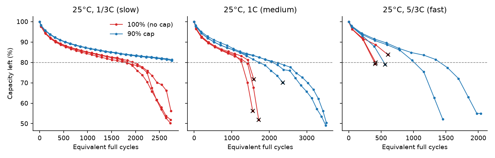
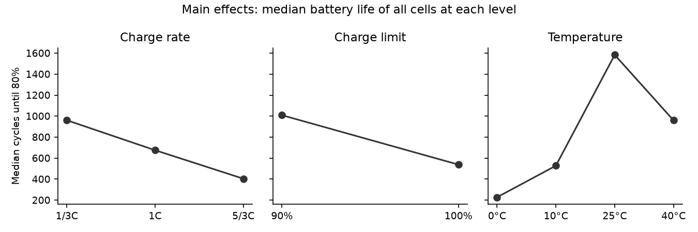

# Preliminary Methods and Results

## Measures

Our outcome is **battery life**: the number of equivalent full cycles until a cell first measures below 80% of its starting capacity. One equivalent full cycle means 3 Ah charged and 3 Ah discharged, the cell's nominal capacity. Capacity comes from KIT's standard check-up, a full slow discharge done every few weeks at room temperature. Because checks are periodic, each cell's life is taken as the midpoint between the last check above 80% and the first check below it. Cells still above 80% when testing ended get an "at least" value. We compare three charge rates (1/3C, 1C, 5/3C), two charge limits (4.09 V, about 90% full, versus 4.2 V, 100%) and four temperatures (0, 10, 25 and 40°C).

## Assumptions

We assume the 80% threshold is a fair definition of a worn-out battery; it is an industry convention, not a value from the data. We drop 3 check-ups measured outside room temperature and the 11 measurements from the final check-up, which KIT ran after its temperature control failed. Missing measurements are left missing. We treat the three cells in each condition as fair repeats, although they shared one temperature bath. 24 of 72 cells stopped early because of an equipment error code; we keep their measurements up to that point. The test cells are 3 Ah cylindrical cells, so applying results to phones is an assumption.

## Model / approach

We follow the Six Sigma DMAIC steps. **Define:** batteries lose capacity too fast; the quality characteristic is cycles until 80% capacity. **Measure:** we read every capacity check-up for the 72 KIT cells in a full 3 × 2 × 4 factorial design, three cells per condition, with discharge fixed at 1C. **Analyze:** we plot capacity fade, find each cell's life, take the median of the three cells in each condition, and compare 90% versus 100% at matching rate and temperature. A main-effects chart shows each factor's overall influence, and a fishbone diagram lists other possible causes. **Improve:** we test whether a 90% cap and slower charging extend life. **Control:** we suggest a default charging policy to hold the gain. We use no fitted statistical model; every result is a direct measurement or simple arithmetic on measurements.

## Results

We used 859 check-ups from 72 cells; 63 cells fell below 80% during testing and 9 did not.

**Capping at 90% extended life in 11 of 12 rate–temperature pairs, and shortened it in none** (Table 1, Figure 2). The remaining pair (0°C, 5/3C) can't be decided, because two uncapped cells stopped on errors before reaching 80%. In 10 pairs every capped cell outlasted every uncapped cell. The typical gain was 2.3× more cycles. At 25°C, capping raised median life from 1,880 to at least 2,759 cycles at 1/3C, 1,337 to 2,136 at 1C, and 321 to 1,068 at 5/3C (Figure 1). Using 70% instead of 80% as the end-of-life point gives the same answer: the cap gave more cycles in 9 pairs and fewer in 0, with a typical gain of 2.8×. The other 3 pairs can't be decided, because fewer cells reached 70% before testing ended (49 of 72).

**Why the cap helps.** Holding a cell near 4.2 V, completely full, stresses the electrodes and speeds up side reactions that consume lithium. Stopping at 4.09 V avoids the most stressful part of every cycle. Figure 1 also shows a "knee": capacity first fades slowly, then drops quickly. Capped cells reach that knee much later.

**Faster charging shortened life.** Across all cells, median life was 949 cycles at 1/3C, 701 at 1C and 317 at 5/3C (Figure 3).

**Temperature mattered most.** Median life was 218 cycles at 0°C, 549 at 10°C, 1,578 at 25°C and 934 at 40°C. Cold plus fast charging was worst: uncapped 5/3C cells at 0°C failed or stopped within 51 cycles. Heat had mixed effects: at 1/3C, uncapped life fell from 1,880 cycles at 25°C to 839 at 40°C, but at 5/3C it rose from 321 to 732. Warmth speeds slow chemical aging, but it also helps lithium enter the electrode quickly; in the cold, fast charging plates metallic lithium on the electrode instead, which destroys capacity.

**Data quality.** 24 cells stopped on error codes, marked × in the figures. The uncapped 5/3C cells at 25°C were all among them: two crossed 80% at their last check, and one stopped at 606 cycles without crossing. Their median is therefore uncertain, while the capped advantage there is still large. The three capped 1/3C cells at 25°C never reached 80%, so their life is a lower bound.

Table 1. Median cycles until 80% capacity (3 cells each); ≥ means at least; ≤ means at most; n/a means both are lower bounds. Last column repeats the gain using 70% as end of life.

| Temp | Charge rate | 100% (no cap) | 90% cap | Cap gain | Gain at 70% |
| --- | --- | --- | --- | --- | --- |
| 0°C | 1/3C | 433 | 814 | 1.9× | ≥1.7× |
| 0°C | 1C | 89 | 341 | 3.8× | 3.8× |
| 0°C | 5/3C | ≥40 | 97 | ≤2.4× | ≤4.3× |
| 10°C | 1/3C | 674 | 1,065 | 1.6× | 1.4× |
| 10°C | 1C | 398 | 701 | 1.8× | 1.8× |
| 10°C | 5/3C | 80 | 270 | 3.4× | 5.0× |
| 25°C | 1/3C | 1,880 | ≥2,759 | ≥1.5× | ≥1.2× |
| 25°C | 1C | 1,337 | 2,136 | 1.6× | 1.8× |
| 25°C | 5/3C | 321 | 1,068 | 3.3× | ≤3.0× |
| 40°C | 1/3C | 839 | 2,083 | 2.5× | n/a |
| 40°C | 1C | 702 | 1,882 | 2.7× | 4.1× |
| 40°C | 5/3C | 732 | 1,513 | 2.1× | 2.8× |

## References

Luh, M., & Blank, T. (2024). Comprehensive battery aging dataset: capacity and impedance fade measurements of a lithium-ion NMC/C-SiO cell. Scientific Data, 11, 1004. https://doi.org/10.1038/s41597-024-03831-x. Version 2 result data: https://doi.org/10.35097/1969 (CC BY 4.0).
