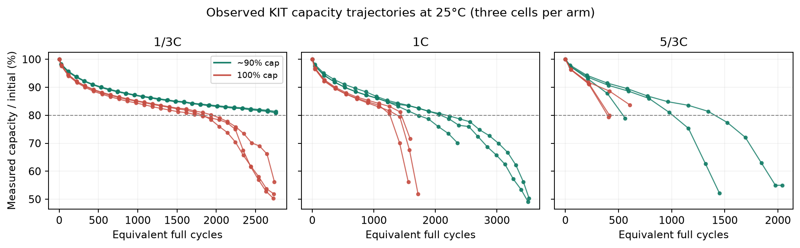
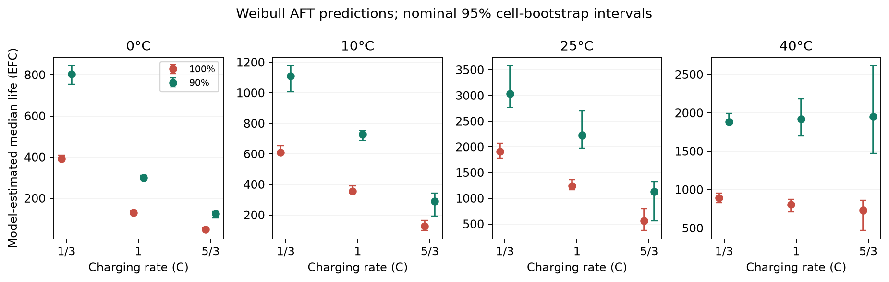
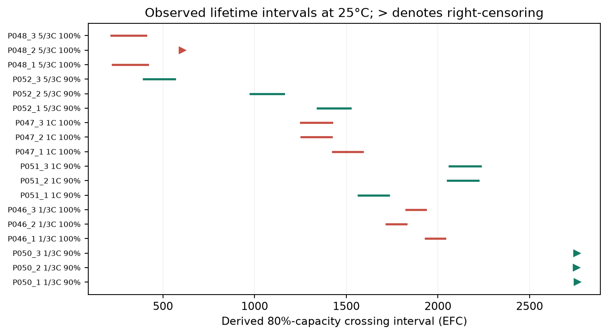

# Preliminary Methods and Results

## Measures

We measure standardized discharge capacity in ampere-hours, then divide by each cell's first valid reference capacity to calculate retention. Our main outcome is equivalent full cycles (EFC) until capacity first falls below 80% of that starting value. Tests are intermittent. We therefore bracket crossings between observations and right-censor cells that haven't crossed. EFC equals average cumulative charging and discharging throughput divided by nominal 3 Ah capacity, after subtracting baseline exposure. We include diagnostic operations and test operating-only exposure separately. We compare charging rate, regular-operation charging cap, and controlled bath temperature. Individual histories and threshold coverage show what we observed; life ratios, median lifetimes, survival probabilities and their confidence intervals come from the model (Luh & Blank, 2024).

## Assumptions

These 72 cells tell us about the KIT experiment. Generalizing to smartphones requires validation. We assume a common Weibull shape and independent cell variation within conditions, although shared baths limit independent temperature replication. Upper voltage gives approximate 90% or 100% caps without continuously recalibrating SOC. Capping changes cycle depth too, preventing isolation of one degradation mechanism. Diagnostics periodically charge both groups fully. We leave missing capacities missing and incomplete lifetimes censored, excluding three flagged cold measurements and the final manual check-up from primary analysis. Alternative models and inclusion rules test sensitivity. Phone projections assume transferable lifetime, constant usage and fresh replacement batteries. These assumptions remain unvalidated.

## Model / approach

We selected 72 KIT cells across 1/3C, 1C and 5/3C charging, approximately 90%/100% caps, and 0, 10, 25 and 40°C baths: three replicates per combination (Luh & Blank, 2024). We fixed discharge at 1C, lower voltage at 3.249 V and upper voltages at 4.092/4.200 V. Checksums verify files; source-row links trace measurements.

We fitted a Weibull accelerated-failure-time model: S(t|x)=exp[-(t/eta(x))^k], t≥0, location zero, common shape k. Scale eta(x)=1000 exp(X beta) EFC is the 63.2% failure quantile; median life equals eta(x)(ln 2)^(1/k). X includes an intercept, binary rate_1third/rate_5third, cap90, temp0/temp10/temp40 indicators and all cross-factor two-way products. Indicators equal zero at reference 1C/100%/25°C; logarithms are natural. Tables give fitted parameters.

Interval likelihoods use measured crossing brackets; survival likelihoods handle right-censored cells. We neither substitute midpoint failure times nor discard incomplete cases. Using seed 20261101, we refitted 2,000 whole-cell bootstrap samples within conditions, preserving joint shape/scale dependence when transforming parameters for percentile intervals. Repeated measurements aren't independent replicates.

We tested interactions with Holm-adjusted likelihood-ratio tests. Three-fold validation withholds one replicate per condition; sensitivity checks vary capacity normalization, throughput, flagged/final measurements and shutdown assumptions. The lognormal alternative uses log(L/1000)=X beta_LN+sigma Z, Z standard normal, sigma=0.181004; its scale equals its median (reference 1,233.257 EFC). Secondary estimates have no bootstrap intervals.

## Results

We analyzed 859 measurements from 72 cells, giving 63 threshold-crossing intervals and 9 right-censored endpoints. We excluded eleven final-manual and three cold measurements without imputing any values. Each condition still has three physical cells. Figure 1 shows their histories; Figure 3 marks censoring with triangles.

At 25°C, uncapped median-life estimates are 1,913, 1,244 and 563 EFC at 1/3C, 1C and 5/3C. With capping, they rise to 3,037, 2,226 and 1,127. At 5/3C, that's a life ratio of 2.00 (nominal 95% CI 1.31–2.92); median intervals are 371–790 EFC uncapped and 561–1,323 capped. These describe fitted distributions. They aren't observed individual lifetimes.

The common shape is 7.018; reference scale is 1,310.708 EFC. Tables 2–3 give parameter intervals and regression coefficients. At 1C/25°C, cap90's coefficient is 0.582 (95% CI 0.422–0.779). Rate-by-temperature gives LR=75.53, six degrees of freedom, Holm-adjusted p<0.001. Rate-by-cap and cap-by-temperature adjusted p-values are 0.372 and 0.372; neither establishes identical benefits. Contrast intervals are unadjusted.

Temperature matters here. At uncapped 5/3C, modeled median life is 48 EFC at 0°C, 563 at 25°C and 734 at 40°C (Figure 2), so this model doesn't support a temperature-independent rate penalty.

All 2,000 bootstrap fits converged. But Weibull predicted poorly: held-out log likelihood totals -463.6, versus -152.7 for lognormal (higher is better). That substantially weakens confidence in our prespecified family. Its intervals leave out distributional uncertainty.

None of the three capped 1/3C/25°C cells crossed the threshold, so their estimated median exceeds measured follow-up. Fault-related shutdowns challenge independent censoring. Shared baths limit temperature replication, while full diagnostic charges and cylindrical, liquid-cooled cells restrict smartphone transfer. We need smartphone-cell validation before promising quantitative phone lifetimes.

Nominal intervals assume the distribution, common shape and within-condition resampling. Lognormal's stronger validation score shows why between-model uncertainty needs separate attention. A positive fitted cap effect establishes neither a precise population benefit nor smartphone transfer.

Table 1. Derived endpoint coverage.

| Bath °C | Cells | Crossings | Right-censored |
| --- | --- | --- | --- |
| 0 | 18 | 16 | 2 |
| 10 | 18 | 17 | 1 |
| 25 | 18 | 14 | 4 |
| 40 | 18 | 16 | 2 |

Table 2. Estimated Weibull parameters: reference 1C/100%/25°C; location fixed.

| Parameter | Estimate | 95% CI |
| --- | --- | --- |
| Shape k | 7.018 | 6.324–12.936 |
| Scale eta (EFC) | 1,310.708 | 1,229.095–1,411.857 |
| Median (EFC) | 1,244.016 | 1,170.005–1,358.010 |
| Location (EFC) | 0 | Fixed |

Table 3. Fitted coefficients: bootstrap SE/CIs; intercept=log(reference eta/1000); log_shape=log(k).

| Term | Estimate | SE | 95% CI |
| --- | --- | --- | --- |
| Intercept | 0.27057 | 0.03698 | 0.20628–0.34491 |
| rate_1third | 0.43010 | 0.04388 | 0.33475–0.50117 |
| rate_5third | -0.79199 | 0.20868 | -1.22389–-0.47809 |
| cap90 | 0.58173 | 0.09103 | 0.42171–0.77870 |
| temp0 | -2.26219 | 0.04644 | -2.34866–-2.16378 |
| temp10 | -1.25396 | 0.05108 | -1.34234–-1.14390 |
| temp40 | -0.43057 | 0.06988 | -0.59860–-0.33028 |
| rate_1third:cap90 | -0.11923 | 0.03977 | -0.19601–-0.04101 |
| rate_5third:cap90 | 0.11117 | 0.16111 | -0.23412–0.38585 |
| rate_1third:temp0 | 0.67701 | 0.04422 | 0.59630–0.76841 |
| rate_1third:temp10 | 0.10998 | 0.04659 | 0.03218–0.21398 |
| rate_1third:temp40 | -0.33172 | 0.07075 | -0.43485–-0.16391 |
| rate_5third:temp0 | -0.19954 | 0.17161 | -0.42121–0.19992 |
| rate_5third:temp10 | -0.23880 | 0.23812 | -0.70403–0.23269 |
| rate_5third:temp40 | 0.69498 | 0.23727 | 0.30261–1.20155 |
| cap90:temp0 | 0.25543 | 0.10486 | 0.03631–0.42430 |
| cap90:temp10 | 0.13738 | 0.12351 | -0.17772–0.30191 |
| cap90:temp40 | 0.28369 | 0.11820 | 0.06040–0.52613 |
| log_shape | 1.94852 | 0.18689 | 1.84442–2.56005 |

Table 4. Approximate interaction tests; Holm correction.

| Interaction | LR | df | Raw p | Holm p |
| --- | --- | --- | --- | --- |
| rate:cap | 3.13 | 2 | 0.209 | 0.372 |
| rate:temp | 75.53 | 6 | 2.98e-14 | 8.94e-14 |
| cap:temp | 4.81 | 3 | 0.186 | 0.372 |

Table 5. Estimated 25°C lifetimes/scales; *median beyond measured follow-up.

| Rate | Cap | eta/EFC | 95% CI | Median/EFC | 95% CI |
| --- | --- | --- | --- | --- | --- |
| 1/3C | 100% | 2,015.1 | 1,861.7–2,159.8 | 1,913 | 1,782–2,069 |
| 1/3C | 90% | 3,200.0 | 2,866.0–3,764.3 | 3,037* | 2,763–3,584 |
| 1C | 100% | 1,310.7 | 1,229.1–1,411.9 | 1,244 | 1,170–1,358 |
| 1C | 90% | 2,345.0 | 2,057.7–2,819.2 | 2,226 | 1,971–2,699 |
| 5/3C | 100% | 593.7 | 388.5–819.6 | 563 | 371–790 |
| 5/3C | 90% | 1,187.1 | 581.3–1,372.3 | 1,127 | 561–1,323 |

## References

Luh, M., & Blank, T. (2024). Comprehensive battery aging dataset: capacity and impedance fade measurements of a lithium-ion NMC/C-SiO cell. Scientific Data, 11, 1004. https://doi.org/10.1038/s41597-024-03831-x. Version 2 result data: https://doi.org/10.35097/1969; supplied README, data dictionary and cell overview. CC BY 4.0; analysis adapted by this project.
